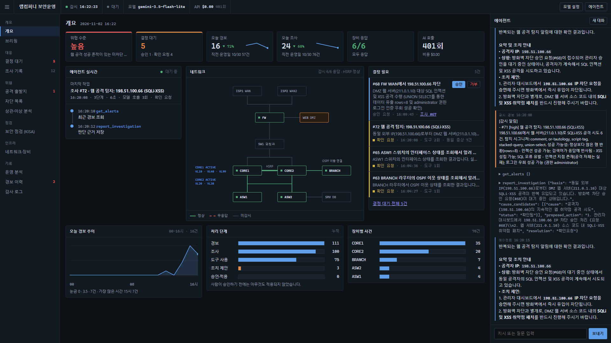
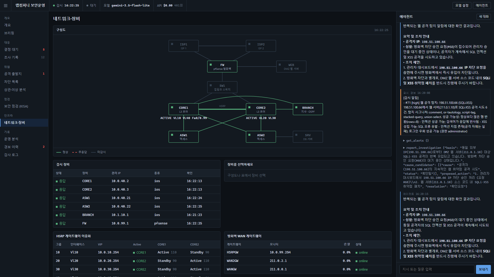
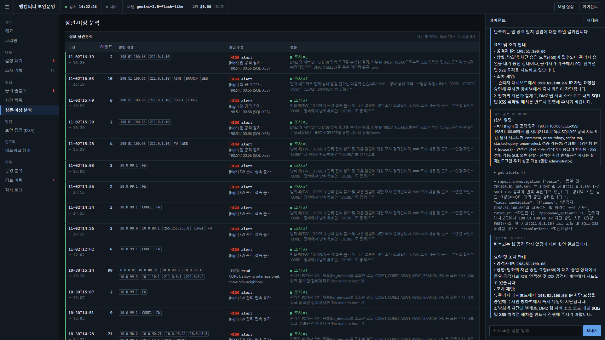
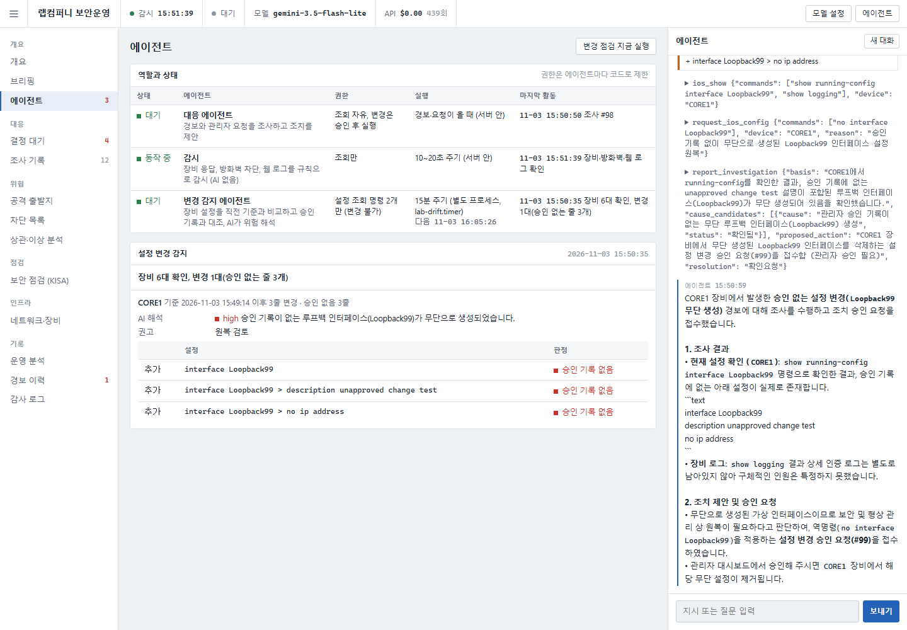

# 랩컴퍼니 IT 운영 에이전트

GNS3 랩(`HSRP-FW-LAB`)을 작은 회사 인프라로 보고, 관리자 PC(AGENT-PC)에 설치한 Claude 기반 운영 에이전트입니다.
에이전트는 네트워크·보안 장비를 직접 조회하고, 변경이 필요하면 **관리자 승인을 받은 뒤에만** 적용합니다.
자동 감시 기능이 포트 스캔, HSRP 전환, 장비 장애, ISP 회선 장애를 탐지하면 에이전트가 원인을 분석합니다.

```
              인터넷 (Claude API)
                    │ VirtualBox NAT  ── 이 PC 브라우저: http://127.0.0.1:8080
            ┌───────┴────────┐
            │ AGENT-PC       │ Rocky Linux · 관리망 VLAN40 · 10.0.40.50
            │ 에이전트 + 대시보드│
            └───────┬────────┘
                    │ telnet(관리 계정, MGMT-ONLY ACL) / SSH 키
   ┌────────┬───────┴─┬─────────┬──────────┐
 CORE1/2  ASW1/2   BRANCH   pfSense FW   (조회·승인된 변경)
```

## 관리자 PC (ADMIN-PC)

시연은 랩 안의 **ADMIN-PC**(Windows 10, 관리망 VLAN40, IP는 코어 DHCP로 자동 할당)에서 합니다.
GNS3에서 ADMIN-PC 콘솔을 열고 로그인하면, 대시보드(`http://10.0.40.50:8080`)가 Edge 앱 창으로 자동으로 열립니다.
바탕화면의 **IT 운영 에이전트** 바로가기로 다시 열 수도 있습니다.
"관리자가 사내 PC에서 관리 서버(AGENT-PC)의 운영 도구에 접속한다"는 구조입니다.
이 PC(호스트) 브라우저의 http://127.0.0.1:8080 도 같은 화면입니다(준비·점검용).

관리망 DHCP는 CORE1(.100~.199)과 CORE2(.200~.250)가 범위를 나눠 맡아서 코어 한 대가 죽어도 할당됩니다.

## 빠른 시작

1. **랩 켜기** (이 PC에서). GNS3가 켜져 있어야 합니다.
   ```bash
   python lab_up.py
   ```
   프로젝트를 열고, 코어 VLAN 복구·코어 재부팅·AGENT-PC 인터넷 연결까지 처리합니다. 약 10~15분 걸립니다.
2. **대시보드 열기**: ADMIN-PC에 로그인하면 자동으로 열립니다 (호스트에서는 http://127.0.0.1:8080)
3. **LLM 모델 설정** (오른쪽 위 **모델 설정** 버튼): 기본은 **Mock**(키 없이 제어 흐름 테스트)입니다. 실제 AI 판단은 **Gemini**(무료, [aistudio.google.com/apikey](https://aistudio.google.com/apikey)) 또는 **Claude**(유료, [console.anthropic.com](https://console.anthropic.com))를 선택하고 키를 등록합니다. 키는 에이전트 PC에만 저장됩니다. 제공자 어댑터 구조라 모델을 바꿀 수 있습니다(`agent/providers/`).
   키는 AGENT-PC의 `/opt/lab-agent/secrets/`에만 저장되고 화면·로그에 다시 나오지 않습니다.

## 운영 콘솔



에이전트가 감시·조사·제안하고 **사람은 판단만 하는** 구조에 맞춰, 지금 판단이 필요한 것부터 보여줍니다.

- **개요(홈)**: 위협 수준·결정 대기·오늘 경보/조사(직전 운영일 대비와 추세선)·장비 응답·AI 호출, 네트워크 요약도, 처리 단계(경보→조사→도구 사용→조치 제안→승인·적용), 장비별 사건
- **에이전트 실시간**: 일하는 중이면 실행 중인 도구·대상 장비·경과 시간을, 쉬는 중이면 마지막 조사의 실제 도구 단계를 보여줍니다. 움직임은 실제 작업에만 생깁니다.
- **결정 필요**: 에이전트가 올린 변경 승인 요청(승인/거부)과 결론을 확정하지 못한 조사. 같은 증상으로 반복된 조사는 하나로 묶습니다.
- 왼쪽 메뉴: **개요 / 대응**(결정 대기·조사 기록) **/ 위협**(공격 출발지·차단 목록·상관·이상 분석) **/ 점검**(KISA) **/ 인프라**(네트워크·장비) **/ 기록**(운영 분석·경보 이력·감사 로그). ☰ 또는 Ctrl+B로 접습니다.
- 오른쪽 **에이전트** 패널에 자연어로 지시합니다. 주소에 `#threats`처럼 화면 이름을 붙이면 그 화면이 바로 열립니다.
- 위협 수준은 근거와 함께 판정합니다. 방화벽이 응답하지 않으면 차단 로그를 볼 수 없으므로 "정상"이 아니라 "확인 불가"로 표시합니다.

| 네트워크·장비 | 상관·이상 분석 |
|---|---|
|  |  |

## 시연 시나리오

| # | 시나리오 | 하는 방법 | 기대 결과 |
|---|---|---|---|
| 1 | 헬프데스크 진단 | 오른쪽 **에이전트** 패널에 "영업팀(VLAN20) PC가 DB 서버에 접속이 안 된대요" 입력 | 에이전트가 경로·HSRP·서버팜 ACL을 조회하고 "VLAN20→서버팜은 정책상 차단"이라고 근거와 함께 설명 |
| 2 | 공격 탐지·차단 | kali(ATTACKER)에서 `sudo nmap -n -Pn --top-ports 40 211.0.1.10 211.0.0.2` (`-n`: 랩에 DNS가 없어 이름 조회에서 멈추지 않게) | 감시 경보 → 에이전트가 방화벽 로그를 분석하고 차단 승인 요청 → **결정 대기**에서 **승인** → pfSense에 차단 적용 → 에이전트가 검증 보고. kali에서 `curl http://211.0.1.10`이 막힘 |
| 3 | 장애 감지·보고 | GNS3에서 CORE1 정지 | HSRP 전환 경보(묶음 1건) + 약 45초 뒤 CORE1 장애 경보 → 에이전트가 영향 범위와 현재 우회 경로 보고. CORE1을 켜면 복구·원위치 경보 |

시나리오 2 시연 후에는 대화로 "198.51.100.66 차단 해제해 줘"라고 요청하면 해제 승인 요청을 만듭니다.

## 보안 점검 (KISA 네트워크 장비 N-01~N-38)

[주요정보통신기반시설 기술적 취약점 분석·평가 방법 상세가이드](https://www.kisa.or.kr/2060204/form?postSeq=22&page=1)(2026년판, 2025-12 발행)의 네트워크 장비 항목 38개로 사내 IOS 장비 5대(CORE1·CORE2·ASW1·ASW2·BRANCH)를 점검합니다. 콘솔의 **점검 › 보안 점검 (KISA)** 화면에서 실행합니다.

| 버튼 | 하는 일 | API 키 |
|---|---|---|
| 규칙 점검 | 설정·버전·인터페이스·CDP·SNMP를 수집해 규칙으로 1차 판정 (약 15초) | 필요 없음 |
| 정밀 점검 | 에이전트가 규칙 판정을 받아 수동확인 항목을 판정하고, 맥락상 틀린 판정을 정정하고, 보고서를 저장하고, 조치를 장비별로 승인 요청 | 필요 |

- 규칙은 설정 문구로 분명한 항목만 판정하고 IOS 12.4 기본값을 반영합니다(예: CDP·source-route·bootp는 설정에 없으면 기본 활성). 권한 수준, 패치, 로깅 정책, 스푸핑·DDoS, 배너 문구처럼 맥락이 필요한 항목은 `수동확인`으로 남겨 AI가 판정합니다.
- 결과표의 칸에 마우스를 올리면 근거(해당 설정 줄)가 보이고, AI가 판정·정정한 칸은 `*`로 표시됩니다.
- 점검 항목표: `agent/kisa_network_checklist.json` (가이드 원문에서 추출, 항목별 판단 기준과 Cisco 점검 예시 포함). 규칙: `agent/audit.py`.
- 비밀번호 해시와 평문은 수집 단계에서 `<가림>`으로 바꿔 AI·대시보드·파일 어디에도 남기지 않습니다.
- 첫 점검 결과(2026-10-29): 190칸 중 취약 93(상 등급 30), 수동확인 27, 양호 70. 대표 취약: 콘솔 로그인 없음·enable 비밀번호 없음(N-01), 비밀번호 암호화 미사용(N-03), 세션 타임아웃 무제한(N-07), telnet 관리(N-08), 원격 로그·NTP 없음(N-11, N-15), 미사용 포트 활성(N-24).

## 웹 공격 탐지 (DMZ, SQL 인젝션·XSS)

DMZ 웹 서버의 접속 로그를 분석해 외부 공격자의 SQL 인젝션·XSS 시도를 탐지하고, 앱 응답으로 성공 여부를 추정합니다. "규칙 탐지 + AI 판정" 구조는 보안 점검과 같고, 로그 분석은 별도 모듈(`agent/web_detect.py`)로 분리해 두었습니다.

- 콘솔 **위협 › 공격 출발지** 화면: 방화벽 차단 기록과 웹 공격을 출발지 IP 하나로 묶어 유형·ATT&CK 기법(T1046 포트 스캔, T1190 공개 웹 앱 공격)·근거·성공 흔적·차단 여부를 보여줍니다. 외부 공격이 들어오면 자동 경보도 올라옵니다(규칙만, API 키 불필요). 경보는 최근 5분(`WEB_WINDOW_SEC`) 안의 요청만 세고, 화면의 이력은 로그 전체를 보여줍니다.
- 경보를 받은 에이전트(키 필요)는 성공 여부를 판정하고, 앞선 포트 스캔과 사건을 연결하고, 차단 승인을 요청하고, 웹 앱 수정이 필요한 부분을 따로 알립니다.
- 방화벽 차단은 출발지를 막을 뿐이고, 인젝션·XSS 취약점 자체는 WEB 앱 수정으로 고쳐야 합니다. 에이전트는 이를 분리해서 알립니다.
- 테스트 포털 설치와 시연 방법: [weblab/README.md](weblab/README.md) (교육용·격리 랩 전용).

## 멀티 에이전트 (설정 변경 감지)



에이전트를 역할별로 나눠, 권한도 역할마다 코드로 따로 제한합니다. 콘솔의 **개요 › 에이전트** 화면에서 역할·권한·상태·마지막 활동을 봅니다.

| 에이전트 | 하는 일 | 권한 | 실행 |
|---|---|---|---|
| 대응 에이전트 (`brain.py`) | 경보와 관리자 요청을 조사하고 조치를 제안 | 조회 자유, 변경은 승인 후 실행 | 경보·요청이 올 때 (서버 안) |
| 감시 (`monitor.py`) | 장비 응답·방화벽 차단·웹 로그를 규칙으로 감시 (AI 없음) | 조회만 | 10~20초 주기 (서버 안) |
| 변경 감지 에이전트 (`drift_agent.py`) | 장비 6대 설정을 직전 기준과 비교 → 바뀐 줄마다 승인 기록과 대조 → AI가 위험도·의미 해석 → 서버에 보고 | `show running-config`, `cat /cf/conf/config.xml` 두 명령만 | 15분 주기 (별도 프로세스, `lab-drift.timer`) |

- **승인 판정은 코드, 해석은 AI.** 바뀐 줄이 실행 완료된 승인 요청(`approvals.json`)과 맞는지는 코드가 정하고, AI는 그 판정을 바꾸지 못합니다. AI 키가 없어도 판정과 경보는 동작합니다.
- **승인 없는 변경이면** 서버가 경보를 올리고, 대응 에이전트가 이어받아 장비를 조회한 뒤 원복 승인을 요청합니다. 에이전트끼리는 서버 API(`/api/agents/report`, 같은 PC에서만 허용)로만 주고받습니다.
- 설정의 비밀번호·키·인증서 값은 저장 전에 `<가림>`으로 바꾸고, AI에는 가린 차이만 보냅니다. 방화벽 설정은 XML을 `경로 = 값` 줄로 펴서 비교해, 같은 규칙·별칭 안의 변경을 한 승인으로 묶어 판정합니다.
- 실측(2026-11-03): CORE1에 승인 없이 Loopback99를 만들고 바로 점검을 실행하자 9초 뒤 경보, 그 뒤 대응 에이전트가 장비 설정·로그를 확인하고 원복(`no interface Loopback99`) 승인을 요청했습니다. 변경이 없을 때 6대를 두 번 비교해 오탐 0건. 정기 실행만으로는 변경 후 최대 15분 안에 잡힙니다.
- 즉시 실행: 화면의 **변경 점검 지금 실행** 버튼, 또는 AGENT-PC에서 `systemctl start lab-drift.service`. 기준과 이력은 `/opt/lab-agent/data/configs/<장비>/`(최근 30개 원문 보관).

## 에이전트가 할 수 있는 일

| 도구 | 종류 | 내용 |
|---|---|---|
| `list_devices`, `get_alerts` | 조회 | 장비 목록·감시 상태, 최근 경보 |
| `ios_show` | 조회 | `show` / `ping` / `traceroute`만 허용. `configure`, `reload`, `debug`, `clear` 등은 거부 |
| `firewall_status`, `firewall_blocked_traffic` | 조회 | pfSense 게이트웨이·룰·차단 목록, 차단 로그를 출발지별 요약 |
| `request_firewall_block` / `unblock` | **변경(승인)** | pfSense WAN 차단 목록(easyrule). 사내·자사 대역(10.0.0.0/15, 211.0.x)은 차단 불가 |
| `request_ios_config` | **변경(승인)** | IOS 설정 + `write memory`. 계정, VTY, 관리 ACL, 부팅 설정은 변경 불가 |
| `run_security_audit`, `get_checklist_item`, `save_audit_report` | 조회 + 보고서 저장 | KISA 점검 실행, 항목 기준 조회, 최종 판정·보고서 저장. 점검 대상은 사내 장비 5대만 |
| `web_attack_scan` | 조회 | DMZ 웹 서버 로그에서 SQL 인젝션·XSS 시도를 출발지별로 요약, 성공 가능성 추정 |

변경 도구는 실행하지 않고 **승인 대기열에만 등록**합니다. 관리자가 대시보드에서 승인해야 실행되고, 실행 결과는 에이전트에게 다시 전달되어 검증합니다. 모든 조회·요청·승인·실행은 감사 로그(`/opt/lab-agent/data/audit.jsonl`)에 남습니다.

## 구성 파일

| 경로 | 내용 |
|---|---|
| `agent/server.py` | 진입점. Flask 앱을 waitress로 실행(감시·에이전트 스레드가 들어 있어 프로세스는 하나). 콘솔과 API(`/api/state`, `/api/chat`, `/api/approve`, `/api/reject`, `/api/apikey`, `/api/overview`, `/api/analytics`, `/api/insights`, `/api/webattacks`, `/api/audit`, `/api/agents`) |
| `agent/brain.py` | LLM 호출 루프(제공자 어댑터 `agent/providers/`: Mock·Gemini·Claude). 관리자 대화·감시 경보·승인 결과가 한 대화로 이어지고, 도구를 실제로 쓴 요청만 조사 기록으로 남김 |
| `agent/state.py` | 조사·경보·승인 상태. 조사(`cases.json`)와 승인 요청(`approvals.json`)은 재시작해도 남고, 번호는 저장된 최대값 다음부터 이어짐 |
| `agent/warehouse.py`, `analytics.py`, `anomaly.py`, `correlate.py` | 운영 데이터 적재·KPI·이상 탐지·상관분석 (설계와 검증: `docs/`) |
| `agent/tools.py` | 도구 정의, 허용 목록, 승인 실행 |
| `agent/monitor.py` | 자동 감시 (방화벽 10초, HSRP·게이트웨이 20초, 액세스 장비 60초). 장애는 45초 유예, 경보는 15초 묶음 |
| `agent/devices.py` | IOS telnet, pfSense SSH 접속 |
| `agent/drift_agent.py`, `deploy/lab-drift.service`, `deploy/lab-drift.timer` | 설정 변경 감지 에이전트(별도 프로세스, 15분 주기) |
| `agent/static/index.html` | 대시보드 화면 |
| `agent/smoke_test.py` | API 키 없이 도구·안전장치 점검 (AGENT-PC에서 실행) |
| `deploy.py`, `deploy/lab-agent.service` | AGENT-PC로 배포(`agent/requirements.txt` 설치 포함), systemd 서비스 |
| `lab_up.py` | 랩 기동 |
| `keys/`, `secrets.env` | 설치용 SSH 키와 장비 관리 계정. **git에 올리지 마세요**(`.gitignore` 처리됨) |

코드를 고친 뒤에는 `python deploy.py`로 다시 배포합니다(서비스 자동 재시작).

## 알아 둘 점

- **랩 전용 보안 수준입니다.** 장비 관리는 telnet이고, 대시보드에는 로그인이 없습니다(이 PC의 127.0.0.1과 사내 관리망에서만 접근 가능). 실제 환경이라면 SSH, 대시보드 인증, 비밀 관리 도구를 써야 합니다.
- **비용:** 무료 Gemini 모델이면 $0, Claude Opus 5.5로 바꾸면 시나리오 1회에 대략 $0.3~0.5입니다. 상단 바의 **API** 항목이 응답 usage로 계산한 추정 누적 비용과 호출 수를 보여 줍니다(정확한 금액은 각 제공자 콘솔). 대화 기록은 자동 캐시되어 이전 기록은 캐시 단가로 읽힙니다.
  시나리오가 끝날 때마다 에이전트 패널의 **새 대화** 버튼으로 대화를 비우면 호출마다 보내는 기록이 짧아져 비용이 줄어듭니다(이전 대화는 `/opt/lab-agent/data/messages-*.json`에 보관).
  감시 경보마다 에이전트가 분석을 돌리므로, 시연하지 않을 때는 랩을 꺼 두세요. 콘솔(Settings → Limits)에서 월 사용 한도를 걸어 두면 안전합니다.
- **GNS3 2.2 + VirtualBox 7 + dynamips의 제약** 때문에 `lab_up.py`가 필요합니다. 프로젝트를 다시 열 때 VM 복제본 디스크 등록이 풀리고, 코어 VLAN이 사라지고, AGENT-PC의 NAT NIC가 덮어써집니다. GNS3에서 직접 열지 말고 `lab_up.py`를 쓰세요.
- **VM 노드에 링크를 연결한 상태에서 어댑터 수를 바꾸지 마세요.** 링크가 실제로는 끊긴 채 남습니다.
- **pfSense는 시리얼 콘솔이 주 콘솔입니다.** 그 파이프를 아무도 비우지 않으면 pfSense가 부팅 중 출력하다 멈추고, GNS3도 그 파이프 읽기에 묶여 API가 응답하지 않습니다. `lab_up.py`는 FW 부팅을 콘솔이 아니라 관리 SSH(10.0.99.1:22) 응답으로 확인하고, 멈추면 시리얼 포트를 분리한 뒤 VM만 리셋합니다(GNS3 reload는 파이프를 다시 붙이므로 쓰지 않음).
