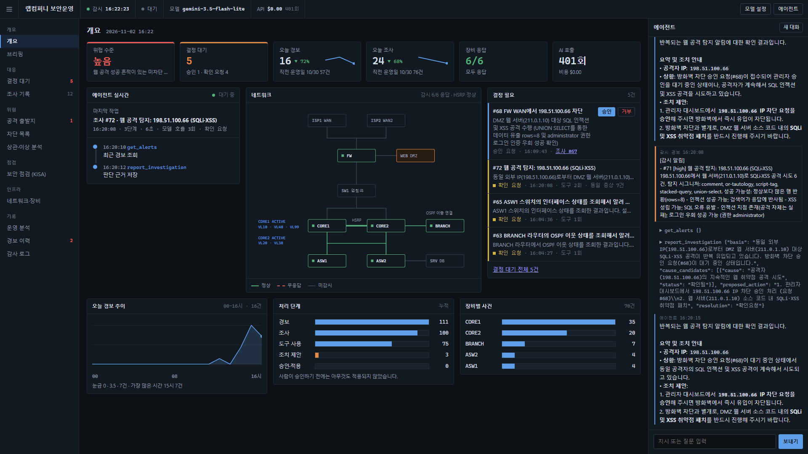

# 사내 IT 운영 AI 에이전트 — 포트폴리오 개요

GNS3로 구축한 가상의 중소기업 네트워크 위에서, **AI 에이전트가 네트워크·보안을 조사·판단·조치**하고
그 운영 데이터를 **수집·분석·평가**하는 엔드투엔드 플랫폼. "AI를 썼다"가 아니라 "**AI가 무엇을, 얼마나
안전하게, 어떤 근거로 개선했는가**"를 실측으로 보여주는 데 초점을 뒀다.

> 모든 수치는 실제 실행으로 측정했다. 확인되지 않은 결과를 성공으로 표시하지 않았고, 수동 운영 시간 등
> 측정하지 않은 값은 날조하지 않았다. 합성/시연 데이터는 그렇게 표시했다(예: 웹 공격은 랩의 ATTACKER가 생성).

## 아키텍처
- **인프라(GNS3)**: HSRP 이중 코어(CORE1/2), 액세스 스위치, OSPF 지사(BRANCH), pfSense 방화벽(ISP 이중화·DMZ),
  서버팜(SRV/WEB), 공격자(Kali), 관리/에이전트 PC. 복구는 `lab_up.py`.
- **에이전트(AGENT-PC)**: 파이썬(Flask + waitress) + SQLite 경량 구성(저RAM). 웹 대시보드 + 자동 감시 + 도구 기반 LLM 루프.
  에이전트 루프(도구 선택 → 코드 권한 검사 → 실행)는 프레임워크 없이 직접 구현해 안전장치를 코드로 통제한다.
- **LLM 교체형**: Mock(무료·키 불필요) / Google Gemini(무료 티어) / Anthropic Claude(유료)를 어댑터로 교체.

## 단계별 구현과 검증 (전부 실측)
| Phase | 내용 | 핵심 검증 결과 | 문서 |
|---|---|---|---|
| 0 | 인벤토리·백업 | 기존 환경 보존 | [phase0](phase0-inventory.md) |
| 1 | LLM 제공자 어댑터(교체형) | Mock 루프 검증 | [phase1](phase1-llm-adapter.md) |
| 3 | 무료 Gemini로 실제 AI 판단 | 3시나리오 $0, Gemini 3.x thought-signature 이슈 해결 | [phase3](phase3-ai-judgment-verification.md) |
| 2 | 조사 기록(판단 근거·도구 실행 시각화) | 관측 가능 근거만 표시, Mock·Gemini 검증 | [phase2](phase2-investigation-trace.md) |
| 4 | 사건 관리 + 변경 작업 관리 | **실제 IOS에 변경·전후비교·실패 롤백 라이브 검증**, 정직한 결론(미해결→확인요청) | [phase4](phase4-incident-change-mgmt.md) |
| 5 | 데이터 파이프라인(수집·정규화·검증·저장) | 실데이터 1,519건 적재·품질 OK·완전 멱등 | [phase5](phase5-data-pipeline.md) |
| 6 | SQL 운영 분석 + KPI 대시보드 | 실데이터 KPI·라이브 대시보드 렌더 | [phase6](phase6-sql-analytics.md) |
| 7 | 에이전트 평가 체계 + 자동화 효과 | 22케이스 실측: 위험 차단 100%·승인없는 변경 0·허위 진단 0·진단 71% | [phase7](phase7-evaluation.md) |
| 8 | 통계 이상 탐지 + 이벤트 상관분석 | ML 보류(데이터 부족, 정직), 통계로 급증 탐지·경보 상관 그룹화 | [phase8](phase8-anomaly-correlation.md) |
| 9 | 대시보드 개선 + 통합 회귀 테스트 + 본 문서 | 회귀 테스트 3/3(모듈·파이프라인·라이브 API) 통과 | (이 문서) |
| + | 멀티 에이전트: 보고 에이전트(별도 프로세스) | 숫자는 코드 집계, 문장은 AI. 실데이터 일일 보고서에서 AI 문장 숫자 전부 집계값과 일치 | [README](../README.md#멀티-에이전트-변경-감지-보고) |
| + | 멀티 에이전트: 설정 변경 감지 에이전트(별도 프로세스) | 실장비 무단 변경 → (즉시 실행 시) 9초 뒤 경보 → 대응 에이전트가 원복 승인 요청, 무변경 오탐 0 | [README](../README.md#멀티-에이전트-변경-감지-보고) |
| + | 보안운영 콘솔 재설계 + 운영 중 발견한 버그 수정 | 판단 중심 홈·에이전트 실시간, 재시작 시 덮어써진 조사 33건을 원본에서 복구(60→93) | [README](../README.md#운영-콘솔) |

## 보안운영 콘솔

"에이전트가 감시·조사·제안하고, 사람은 판단한다"는 역할 분담을 화면 구조로 옮겼다. 홈은 사람의 판단이 필요한 것부터 보여준다.
- **개요(홈)**: 위협 수준·결정 대기·오늘 경보/조사(직전 운영일 대비)·장비 응답, 네트워크 요약도, 처리 단계(경보→조사→도구 사용→조치 제안→승인·적용)
- **에이전트 실시간**: 작업 중이면 실행 중인 도구·대상 장비·경과 시간, 쉬면 마지막 조사의 실제 단계. 실측 예: 웹 공격 탐지(15:29:18) → 자동 조사(15:29:33) → 차단 승인 요청(15:29:40), **탐지 후 22초 만에 조치 제안**, 이후는 사람의 결정
- **결정 필요**: 승인 요청과 결론 미확정 조사. 승인 전에는 아무것도 적용되지 않는다(처리 단계 그래프의 "승인·적용 0")
- **위협·점검·인프라·기록** 메뉴: 공격 출발지(방화벽 차단 + 웹 공격, ATT&CK), 차단 목록(승인 근거 연결), 상관·이상 분석(Phase 8), KISA 점검, 네트워크·장비, 운영 분석, 감사 로그
- 위협 수준은 근거와 함께 판정한다. 방화벽이 응답하지 않으면 "정상"이 아니라 "확인 불가"로 표시한다.

## 핵심 설계 결정 (정직한 엔지니어링)
- **교체형 LLM**: 모델별 요구사항(예: Gemini 3.x thought-signature)을 어댑터가 흡수 → 설계가 실모델에서 검증됨.
- **도구 실행 계층에서 권한 강제**: 프롬프트가 아니라 코드로 위험 명령·승인 없는 변경을 차단(평가에서 0건 확인).
- **정직한 결론**: 해결 못 한 사건을 '해결'로 표시하지 않고 '확인요청/미해결'로(안전망). 평가 허위 진단율 0.
- **안전한 변경 관리**: 백업 → 적용(미저장) → 전후 비교 → 실패 시 롤백 → 성공 시에만 저장(실IOS 검증).
- **데이터 우선, ML은 필요할 때만**: 데이터 양·품질을 먼저 평가해 ML을 무리하게 적용하지 않음.
- **비용 최소화**: 무료 모델 우선, 포트폴리오 데모/반복 테스트 비용 $0.
- **원본 보존이 실제로 데이터를 살렸다**: 에이전트 재시작 때 조사 번호가 1부터 다시 매겨져, 번호로 저장하던
  웨어하우스에서 나중 조사가 예전 기록을 덮어쓰고 있었다(한 번호에 최대 9건). 수집 단계에서 원본(raw)을 보존해
  둔 덕분에 키를 `번호@시작시각`으로 바꾸고 33건을 원본에서 복구했다(60→93건). 승인 요청도 재시작 후 유지되도록 저장한다.
- **실공격 시험이 탐지 버그를 드러냈다**: kali에서 실제 포트 스캔·웹 공격을 보내 보니, 포트 스캔은 경보 후 16초 만에
  차단 승인 요청까지 갔지만 웹 경보는 예전 로그(5일 전 공격)로 10분마다 다시 울리고, 그 10분 동안의 새 공격은 중복으로
  묻히고 있었다. 웹 경보에 최근 5분 시간 창을 두고, 가장 흔한 `' OR '1'='1`(끝 따옴표를 앱 쿼리가 닫는 형태)을 놓치던
  규칙도 고쳤다.

## 한계 (솔직히)
- lite 모델은 중첩 구조화 출력(원인 후보·resolution)을 불안정하게 채움 → 안전망/폴백으로 보완.
- §8 상관분석의 시간 창은 플러드 구간을 과다 병합. ML은 데이터가 쌓이면 활성화 예정.
- §8 상관분석의 "검증됨" 판정이 느슨하다. 같은 날 관련 조사가 있으면 검증으로 연결해, 현재 묶음 대부분이 검증으로 표시된다(시간 창 안으로 좁힐 예정).
- §8 수동 운영 기준시간은 사람이 직접 측정해야 함(프로토콜 제공, 날조 금지).
- 변경 감지는 '승인 기록과 맞는가'만 본다. 승인 없이 바뀌었다가 다음 점검 전에 원래대로 돌아온 변경은 놓친다(15분 주기).
  누가 바꿨는지는 장비 로그에 남아 있을 때만 알 수 있다(랩 장비는 원격 로그가 없음). 한 번 보고한 변경은 다음 비교의 기준이 된다.

## 실행 방법 (요약)
- 랩 복구: 호스트에서 `python company-agent/lab_up.py` (GNS3 필요).
- 에이전트: AGENT-PC에서 `lab-agent` systemd 서비스. 대시보드 `http://127.0.0.1:8080`.
- 분석/평가 CLI(AGENT-PC): `python warehouse.py --quality`, `python analytics.py`, `python anomaly.py`,
  `python correlate.py`, `python evaluate.py --subset safety`, `python regression_test.py`.
- 테스트: `warehouse_test.py`, `phase8_test.py`, `regression_test.py`.
